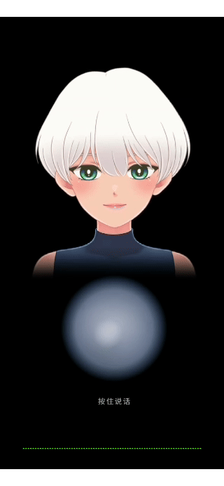

# 完全免费的 AI 数字人方案

区别于各大厂商的 **云平台虚拟数字人** ，这类方案的形象定制费用高，在线并发也受配额限制。

本方案在端侧完成渲染：
+ 角色形象、动作与交互由本地资产定义，可按场景自由配置；
+ 每一路画面由终端独立绘制，不占用云端并发；
+ 口型依据当前播放音频实时解算，与语音保持同步。

> 声明：本仓库不提供完整的 AI 交互实现，只提供端侧数字人在形象定制、动作定义，以及 **口型与语音实时同步** 上的落地方案。

## 效果演示

## 方案描述

多数业务已经具备完整的 AI 对话流程，包括语音识别、大模型推理和语音合成。

> 本方案接在这条流程之外：原有的会话编排、提示词和接口保持不变，数字人只承接对话已经生成的结果，不参与对用户语义的理解。

1. 对话流程产出回复音频后，将该音频交给数字人播报。
2. 数字人按播放进度实时驱动口型，使嘴部动作与语音同步。
(回复内容变化时，只需更换音频数据，无需重新制作口型动画)

基于本方案，使用方可以自行设计数字人的动作交互，例如伴随呼吸、眨眼，或在特定场景中加入倾听等姿态。这些动作与口型并行生效。

### Live2D 与 CRI Middleware

本项目使用 Live2D 和 CRI Middleware 实现核心能力。

`live2d/sdk` 存放下载好的 Live2D SDK：`cubism-sdk-native` 负责绘制，`cubism-sdk-motionsync` 负责口型，其中包含 CRI Middleware。

- 绘制：[Cubism SDK for Native](https://www.live2d.com/zh-CHS/sdk/download/native/)
- 口型：[Cubism SDK MotionSync Plugin for Native](https://www.live2d.com/zh-CHS/sdk/download/motionsync/)

Live2D 负责角色形象与动作。它**把一张二次元插画做成可以实时驱动的 2D 角色**，无需 3D 建模，靠图层变形、骨骼和物理模拟实现转头、眨眼、张嘴和头发摆动，适用于端侧数字人与语音交互。

CRI Middleware 负责口型。它**把正在播放的声音实时解析成嘴型**，按音频中的元音强弱驱动嘴部开合，使口型与语音同步，无需为每段台词单独制作口型动画。

角色可以自己制作，也可以使用网上已有的模型。自己制作时，用 Live2D Cubism Editor 把插画拆成部件，设置变形、骨骼和物理后导出；使用现成模型时，选用授权允许嵌入应用的作品即可。模型放入 `app/src/main/assets/live_2d_model/`，目录名与 `.model3.json` 的文件名一致，运行时会自动加载。本仓库当前使用的是 Live2D 官方免费示例 Kei。

- 制作工具：[Live2D Cubism Editor](https://www.live2d.com/zh-CHS/cubism/download/editor/)

- 本仓库使用的免费模型：[Kei](https://www.live2d.com/en/learn/sample/kei/)

### 如何使用 Live2D 制作模型角色

原画不要合并成一张图。在绘图软件里按会动的部件分层，导出 PSD，再交给 Live2D Cubism Editor。

图片需要做这些处理：

1. 使用透明背景，不要留白底或场景。
2. 按会单独运动的部分拆成图层。前发、侧发、后发分开；左右眼的眼皮和眼珠分开；眉毛、脸、身体、衣服分开。需要独自摆动的发束各自一层。
3. 被挡住的地方画完整。头发盖住的额头、衣服盖住的身体都要画全，转头或变形后露出来的地方才有像素。
4. 相邻图层的交界多画一圈。嘴和脸、眼皮和眼珠、头发和额头重叠一点，网格拉伸时才不会裂开。
5. 嘴单独准备口型。至少要能张开、闭合，并分出 A、I、U、E、O 五种嘴形。可以做成多张嘴的图层，也可以把上唇、下唇、口腔和牙齿拆开，让参数去拉。
6. 图层命名清楚，各层画布对齐。导出贴图常用边长 2048，与当前 Kei 模型一致；图越大，显存占用越高。

导入 Cubism Editor 之后，为每个图层生成网格，用变形器把转头、眨眼、张嘴绑到参数上，再给头发加物理。导出 `.moc3`、`.model3.json`、贴图和 `.physics3.json`。要对上本仓库的口型，嘴部参数使用 `ParamMouthOpenY`、`ParamA`、`ParamI`、`ParamU`、`ParamE`、`ParamO`，并配一份 `.motionsync3.json`。

### 口型怎么跟上声音

原理：闭源的 CRI 口型引擎把一段声音判成五个元音的强弱，再按 `motionsync3.json` 的口型表写成嘴部参数。中文没有单独的声母韵母模型，被近似成这五个元音。

大约每秒 60 次，引擎从缓冲里取一段采样，得到 `Silence`、`A`、`I`、`U`、`E`、`O` 的强弱。元音怎么从波形里判出来，在 `libLive2DCubismMotionSyncEngine_CRI.so` 里。

`Mappings` 把这些强弱合成嘴型。例如判成 `A` 时，张开嘴并拉高 `ParamA`，其余元音参数为 0。平滑之后写入 `ParamMouthOpenY`、`ParamA`、`ParamI`、`ParamU`、`ParamE`、`ParamO`。`moc3` 用这些值变形嘴部网格。

模型变形用的是另一个 Live2D 库 Cubism Core。它按参数把网格画出来，不听声音。

## 关键代码

当前数字人是 Kei，放在 `app/src/main/assets/live_2d_model/Kei_vowels/`。目录名必须和 `Kei_vowels.model3.json` 的文件名一致。运行时扫描 `live_2d_model/`，找到「文件夹名 + `.model3.json`」就加载；先读这个 json，再按里面的相对路径读其余文件。

一个完整的模型里有如下文件：

| 后缀 | 作用 |
|---|---|
| `.model3.json` | 模型设定，整个角色的入口。 |
| `.moc3` | 模型数据。网格、变形、部件和参数。 |
| `.png` | 贴图。 |
| `.motion3.json` | 动作。按时间记录参数曲线，播出来是一段动画。 |
| `.motionsync3.json` | 口型设定。规定音频分析结果写到哪些参数，里面没有时间轴。 |
| `.physics3.json` | 物理。头发等随头和身体的角度摆动。 |
| `.pose3.json` | 姿势。这份 Kei 模型没有导出。 |
| `.exp3.json` | 表情。这份 Kei 模型没有导出。 |
| `.cdi3.json` | 参数显示名。给 Cubism Editor 看，绘制时不读。 |

项目里我封装了几个方法，集中在 `MainActivity.kt`，用来驱动角色形象：

| 方法 | 作用 |
|---|---|
| `playSpeech` | 对口型播报一段音频。传入带文件头的音频数据流，角色边出声边对上嘴。 |
| `blinkEyes` | 按模型里的预设循环眨眼。 |
| `swayBody` | 头和身体轻微往复晃动，并带一点呼吸。 |
| `listenClosely` | 把头和身体转到侧耳倾听的角度，并保持这个姿态。 |
| `cancelListen` | 从当前角度缓缓回到正面。 |
| `switchModel` | 切换模型。当前只有一个模型时等于重新加载角色。 |

